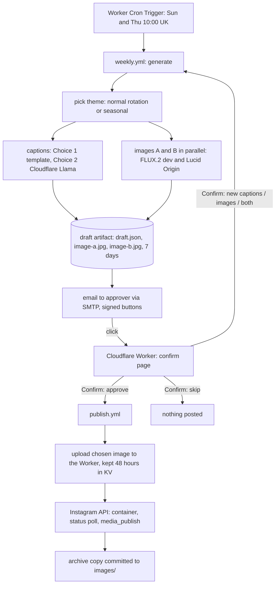

# Architecture

## Flow

## Components
- **`post_weekly.py generate`** (`weekly.yml`): chooses the theme, builds captions that pass the compliance check, generates image A and image B concurrently (if one fails the draft continues with the other), writes `out/draft.json`, `out/draft.md`, `out/image-a.jpg`, `out/image-b.jpg`, uploads them as the `draft` artifact and sends the email. Modes via env `MODE`: `new`, `captions` (keep images), `image` (keep captions), `all`. Regenerations pass `PREV_RUN_ID` and `REGENS_USED`.
- **`approval_email.py`**: HTML and plain-text email with inline images (CIDs `postimage-a`, `postimage-b`), Instagram-style caption previews, "Post with image A / B" buttons per caption, regeneration and skip buttons, Outlook-safe buttons, inbox preview line. Subject: `Approve <weekday>'s post: <topic>`.
- **`worker/worker.js`**: `GET /a/<token>` shows a confirmation page and changes nothing; `POST /c/<token>` verifies the signature and expiry, applies the per-draft rules in KV, then dispatches `publish.yml` or `weekly.yml` through the GitHub API. Its `scheduled` handler (Cron Trigger `0,30 9,10 * * *` UTC) dispatches `weekly.yml` with `mode=new`, `refresh_token=true`, `source=cloudflare` once per UK day on the days in `DRAFT_DAYS` (default `sun,thu`) at the UK hour `DRAFT_UK_HOUR` (default 10); `DAILY_DRAFT=test` makes it a TEST draft and `off` stops it.
- **`post_weekly.py publish`** (`publish.yml`): downloads the draft artifact by run id, refuses expired or test drafts and unknown option or image, hosts the chosen image (see Image hosting), posts through `graph.instagram.com` and logs the media id.
- **`post_weekly.py refresh`**: exchanges the 60-day Instagram token for a fresh one and saves it back to the `IG_ACCESS_TOKEN` secret (needs `GH_PAT`). It runs as the `refresh-token` job on every Cloudflare-started scheduled draft (twice a week, well inside the token's 60 days), or a manual run with `refresh_token` ticked.

## Image hosting
Instagram fetches the post image from a public https link. `IMAGE_HOST` (GitHub variable) chooses where it comes from:
- `cloudflare` (for a private repo): `publish.yml` POSTs the JPEG to the Worker at `/img` with headers `X-FDC-Time` (epoch seconds) and `X-FDC-Signature` = hex HMAC-SHA256(`LINK_SECRET`, `"img-upload." + time + "." + hex SHA-256 of the body`). The Worker accepts a signature once and only within 5 minutes, only JPEGs up to 8 MB, stores the image in KV as `img:<32 random hex>` with an expiry of `IMAGE_HOURS` (default 48) and returns `<worker>/img/<id>.jpg`, which it serves to anyone (Instagram) until KV deletes it. After the post is live the job commits an archive copy to `images/`; if that fails it only warns.
- `github` (default; needs a public repo): commits the image to `images/` and uses GitHub's download link.
- `imgbb`: uploads to imgbb with `IMGBB_API_KEY`.

## Link tokens
`token = base64url(JSON payload) + "." + base64url(HMAC-SHA256(LINK_SECRET, base64url(JSON payload)))`

| Key | Meaning |
|---|---|
| `a` | action: `approve`, `captions`, `image`, `all`, `skip` |
| `d` | draft run id (GitHub run id that made the draft) |
| `c` | chosen caption option number (approve only) |
| `i` | chosen image letter A or B (approve only; missing means A) |
| `l` | caption label |
| `w` | draft chain id: scheduled run plus its regenerations |
| `e` | expiry, epoch seconds (5 days) |
| `t` | post topic |
| `x` | 1 for a test (dry run) draft |

## Worker state (KV `STATE`, keys expire after 14 days unless stated)
`used:<sha256 of token>` single-use links; `decided:<chain>:live` one approval or skip per draft; `regen:<chain>:<scope>` regeneration count per draft. Test drafts (`x=1`) use scope `test` and have no lock and no cap. `daily:<UK date>` (3 days) the day's draft has started. `img:<id>` a post image (`IMAGE_HOURS`, default 48 hours); `upsig:<signature>` a used upload signature (10 minutes).

## draft.json
`week` (chain id), `theme`, `topic`, `mode`, `generated_at`, `expires_at`, `regens_used`, `dry_run`, `images` (list of `id`, `file`, `person`, `prompt`), `candidates` (list of `number`, `id`, `label`, `caption`, `alt_text`, ...). Older drafts with a single `image.jpg` are still readable as image A.

## Themes
`themes.json` holds 12 normal themes (`id`, `topic`, `angle`, `image` for A, `image_b` for B). `calendar.json` holds seasonal themes by month, with optional `days` window and `pin`. `pick_theme` takes every Nth post (`seasonal_every`, default 3) from the month's seasonal themes and otherwise the next normal theme, rotating by day. The `angle` is used for captions only.

## Settings and secrets (names only; values are never in the repo)
GitHub secrets: `IG_ACCESS_TOKEN`, `GH_PAT` (Secrets read/write, for token refresh), `CLOUDFLARE_ACCOUNT_ID`, `CLOUDFLARE_API_TOKEN` (Workers AI), `SMTP_USER`, `SMTP_PASSWORD`, `MAIL_FROM`, `APPROVER_EMAIL`, `LINK_SECRET`. GitHub secret for deploys: `CLOUDFLARE_DEPLOY_TOKEN` (Workers Scripts edit). GitHub variables: `APPROVAL_BASE_URL` (also used by `publish.yml` with `IMAGE_HOST=cloudflare`), `SMTP_HOST` (default smtp.livemail.co.uk), `SMTP_PORT` (default 587), optional `IMAGE_PROVIDER`, `IMAGE_MODEL_A`, `IMAGE_MODEL_B`, `IMAGE_HOST`.
Optional variable `CLOUDFLARE_WORKER_NAME`. Worker: secrets `LINK_SECRET` (same as GitHub) and `GH_TOKEN` (fine-grained, Actions read and write on this repo); text `GH_REPO`, `GH_REF`, `MAX_REGENS`; KV binding `STATE`.

## External services
Instagram API with Instagram Login (no Facebook Page), Cloudflare Workers AI (images and caption Choice 2), Cloudflare Worker and KV, GitHub Actions and Pages, SMTP mailbox at UK2 (`smtp.livemail.co.uk`).
